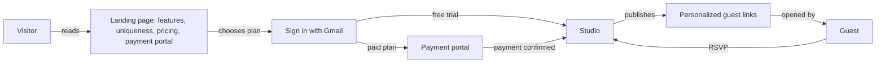
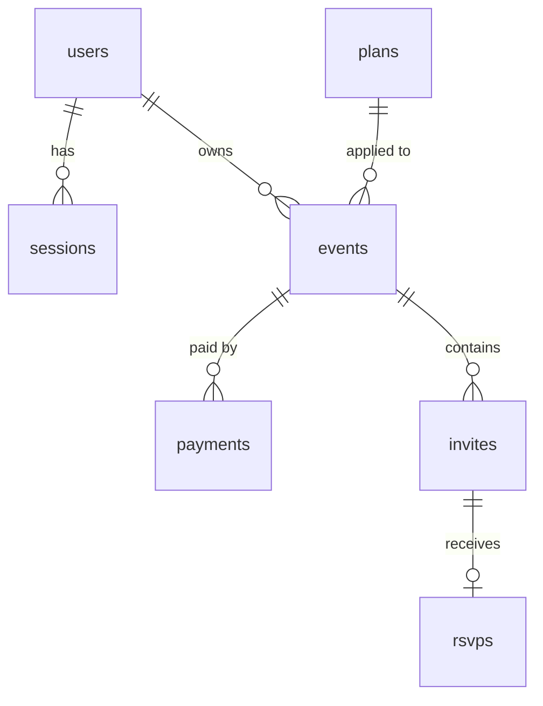

# URLovingly — Software Requirements Specification

| | |
|---|---|
| **Product** | URLovingly — personalized digital event invitations |
| **Document status** | Version 1.0 |
| **Scope of this version** | Marketing site, plan selection and payment, Gmail sign-in, plan-gated invitation studio, guest-link hosting |

---

## 1. Introduction

### 1.1 Purpose
This document specifies what URLovingly must do. It is written for the product owner, developers and testers. Every functional requirement has an ID (`FR-…`), an acceptance criterion, and is traced to automated tests in section 11.

### 1.2 Product summary
URLovingly lets a host (the *customer*) turn a celebration into an animated mobile invitation website and publish a **separate personalized link for every guest or family** (for example `/aarav-and-priya/to/rahul-sharma/`). Customers first see a public page explaining what the product offers and why it is different, then choose a plan (a free trial or one of two paid plans, priced per event), sign in with Gmail, pay if required, and only then reach the invitation studio. The studio shows exactly the options included in the customer's plan.

### 1.3 Definitions

| Term | Meaning |
|---|---|
| Customer / host | The person who signs in, buys a plan and creates invitations |
| Guest | A recipient who opens a personalized invitation link; guests never sign in |
| Event | One celebration owned by a customer. A plan is attached to an event ("per event" pricing) |
| Guest link (invite) | One published personalized page for one guest or family |
| Studio | The authenticated page where event details and guests are entered and invitations are generated |
| Plan | Free Tier (Trial), Standard Celebration or Grand Celebration |
| Paise | 1/100 of a rupee. All amounts are stored in paise |
| Shagun | A monetary gift offered to the hosts, paid here through UPI |

### 1.4 Assumptions made where the brief was silent
These are decisions taken by the specification; change them in `server/plans.py` if the business decides otherwise.

| ID | Assumption |
|---|---|
| A-1 | The Free Tier keeps links live for **7 days** (the brief gives no hosting period for the trial). |
| A-2 | **Grand includes every Standard feature** (WhatsApp generator and RSVP dashboard) in addition to its own. |
| A-3 | "6 months" of hosting is 180 days and "1 year" is 365 days, counted **per link from the day it is first published**. |
| A-4 | The free trial can be claimed **once per Google account**. |
| A-5 | All invitation designs, event types and mail-arrival animations are available on every plan. |
| A-6 | A customer may buy several events (one payment each) and may upgrade an event by paying the price difference. |
| A-7 | Gmail-only sign-in means addresses ending in `gmail.com` or `googlemail.com`; the list is configurable. |

---

## 2. Users and context

| Actor | Description |
|---|---|
| Visitor | Anyone viewing the public landing page |
| Customer | A visitor signed in with Gmail |
| Guest | Opens a published link; may reply to RSVP when the plan allows |
| Payment gateway | Razorpay (UPI, cards, netbanking, wallets) |
| Identity provider | Google Identity Services |

---

## 3. Plans and entitlements

### 3.1 Plan definitions

| | Free Tier (Trial) | Standard Celebration | Grand Celebration |
|---|---|---|---|
| Price | ₹0 | **₹999 / event** | **₹2,499 / event** |
| Personalized guest links | up to **5** | up to **100** | up to **500** |
| Link hosting | 7 days (A-1) | **6 months** | **1 year** |
| WhatsApp message generator | – | ✓ | ✓ |
| Live RSVP dashboard | – | ✓ | ✓ |
| Multi-day selective event routing | – | – | ✓ |
| UPI Shagun integration | – | – | ✓ |
| Custom background audio | – | – | ✓ |

### 3.2 Upgrade prices
Upgrade price = target plan price − current plan price: Free→Standard ₹999, Free→Grand ₹2,499, Standard→Grand ₹1,500. Downgrades are not offered.

---

## 4. Functional requirements

Priority: **M** = must have. All requirements below are M.

### 4.1 Landing page (public)

| ID | Requirement | Acceptance criterion |
|---|---|---|
| FR-LP-01 | The first page (`/`) is public and needs no sign-in. | `GET /` returns 200 for an anonymous visitor. |
| FR-LP-02 | It explains **what the product provides** (personalized links, 8 designs, event types, maps/photos/schedule, sharing, hosting). | Section `#features` is present. |
| FR-LP-03 | It explains **what makes the product unique**: animated envelope arrival, scratch-to-reveal date with countdown, multi-day selective routing, UPI Shagun, live RSVP, custom background audio. | Section `#unique` is present and mentions each item. |
| FR-LP-04 | It explains how it works in four steps. | Section `#how-it-works` is present. |
| FR-LP-05 | It shows the **three pricing options** exactly as defined in section 3.1, with a free-trial call to action ("Start free trial"). | Section `#pricing` lists name, price, link limit and highlights for every plan; the text matches `server/plans.py`. |
| FR-LP-06 | The **payment portal is on the first page**: a secure checkout dialog opens from the pricing cards without leaving the page, and a `#payment` section explains the payment methods. | `#checkoutModal` and `#payment` exist; the dialog shows plan, amount and a Pay button. |
| FR-LP-07 | The page never contains payment-gateway secrets. | No `key_secret` or live key in the page source. |
| FR-LP-08 | A signed-in customer sees their email, an "Open studio" button (when they have an active event) and "Sign out". | Manual check; `/api/me` drives the header. |

### 4.2 Authentication and customer records

| ID | Requirement | Acceptance criterion |
|---|---|---|
| FR-AU-01 | Customers sign in with **Google**; the server verifies the Google ID token (signature, audience, expiry) before trusting it. | A token that fails verification is rejected with 401 and creates no user. |
| FR-AU-02 | Only **verified Gmail** addresses are accepted (A-7). | A non-Gmail or unverified address gets 403. |
| FR-AU-03 | **Customer details are stored**: email, name, picture, Google subject id, created and last-login timestamps. A returning customer updates the existing record; no duplicates. | Row exists in `users` after login; a second login leaves one row. |
| FR-AU-04 | A successful login issues a random session token in an `HttpOnly`, `SameSite=Lax` cookie (and `Secure` outside development). Only a SHA-256 hash of the token is stored. | Cookie flags verified; stored value ≠ cookie value. |
| FR-AU-05 | Sessions expire after 7 days and end immediately on sign-out. | Requests after expiry or logout return 401. |
| FR-AU-06 | Every customer API call and the studio require a valid session. | Anonymous calls return 401. |
| FR-AU-07 | A developer sign-in (any Gmail address, no Google) exists **only** when `URLOVINGLY_ENV=development`. In production the server refuses to start with it enabled. | `POST /api/auth/dev-login` returns 404 when disabled; production start-up check raises. |

### 4.3 Plan selection, subscriptions and payment

| ID | Requirement | Acceptance criterion |
|---|---|---|
| FR-SU-01 | Choosing a plan creates an **event** that stores the customer, the plan, the title and the status. Plan and customer details are therefore persisted in the database. | `events` row with `plan_id` and `user_id`. |
| FR-SU-02 | The **free trial** activates immediately, without payment, once per account (A-4), even after the trial event was upgraded. | Second trial request returns 409 `trial_already_used`. |
| FR-SU-03 | A **paid plan** creates an event in `pending_payment`. No paid feature and no publishing is available until payment succeeds. | Publishing/feature calls on a pending event return 402. |
| FR-SU-04 | Choosing the same unpaid paid plan again reuses the pending event instead of creating duplicates. | Same event id returned. |
| FR-SU-05 | The payable **amount is always taken from the server-side price**; any client-supplied amount is ignored. | Order amount equals plan price in paise (99 900 / 249 900). |
| FR-SU-06 | A payment order is created with the gateway and stored (`payments`: order id, amount, currency INR, status). | Row in `payments` with status `created` then `paid`. |
| FR-SU-07 | Payment is confirmed by verifying the gateway **signature** (`HMAC-SHA256(secret, order_id\|payment_id)`). A forged or missing signature never activates a plan. | Invalid signature returns 400 and the event stays `pending_payment`. |
| FR-SU-08 | The gateway **webhook** (`payment.captured`, `order.paid`) also activates the event, so a customer who closes the browser after paying is not stranded. Webhook signature and amount are verified. | Valid webhook activates; bad signature or wrong amount does not. |
| FR-SU-09 | Settlement is **idempotent**: repeating confirmation never double-activates or double-records. | One paid payment row after two confirmations. |
| FR-SU-10 | A customer can only pay for, view or use **their own** events and payments. | Other accounts get 404. |
| FR-SU-11 | A customer can **upgrade** an active event; the charge is the price difference; the plan changes only after payment; existing links are kept and their hosting period is recalculated for the new plan. | See section 3.2; links retained with new expiry. |
| FR-SU-12 | Downgrades and same-plan "upgrades" are rejected. | 400 `not_an_upgrade`. |
| FR-SU-13 | A customer can list their payment history. | `GET /api/payments` returns only own rows. |
| FR-SU-14 | A gateway outage returns a clear 502 and creates no payment row. | 502 `payment_gateway_error`. |
| FR-SU-15 | A **mock** payment provider exists for development only; production requires Razorpay credentials. | Production start-up check raises without keys. |

### 4.4 Studio (only after sign-in)

| ID | Requirement | Acceptance criterion |
|---|---|---|
| FR-ST-01 | The studio (guest and event details form, templates, live mobile preview) is served at `/studio` **only to a signed-in customer with at least one active event**. | Anonymous → redirect to `/?signin=1`; no active event → redirect to `/?choose=plan`; unpaid-only → redirect. |
| FR-ST-02 | The studio source and invitation templates are not reachable as public static files. | `/private/studio.html`, `/studio.html`, `/schema.sql` etc. return 404; `/templates/…` returns 401 when anonymous. |
| FR-ST-03 | The studio shows **only the options included in the selected event's plan**; options outside the plan are hidden (`data-feature` attributes), and an Upgrade button is offered unless the plan is Grand. | Feature list in `/api/me` equals plan entitlements; studio marks each gated block. |
| FR-ST-04 | A customer with several events picks one from a selector; the plan, usage strip and visible options change accordingly. | Manual check. |
| FR-ST-05 | A usage strip shows plan name, links used of the limit, and hosting period. | Manual check; values from `event_dict`. |
| FR-ST-06 | The studio collects the event details and guest details for generation: event type and ceremonies, family names, date/time, venue, map, parking, meal, host contacts, guest name, optional photos (≤3), personal note, design, mail-arrival style. | Existing form behaviour preserved. |
| FR-ST-07 | The live preview shows the guest page as the guest will first see it. RSVP, UPI and audio blocks are added when the link is published, not in the preview. | Documented limitation. |
| FR-ST-08 | A customer can download the guest-list CSV template, upload CSV or XLSX, preview parsed guests, and publish individually personalized invitations within the selected event's remaining plan quota. Existing guests may be updated without consuming another link; invalid or over-capacity uploads are rejected before publishing. | `test_imports.py`: CSV/XLSX parsing, malformed/oversized files, authenticated preview, event ownership; manual studio check for template download and publishing. |

### 4.5 Guest links (all plans)

| ID | Requirement | Acceptance criterion |
|---|---|---|
| FR-IN-01 | Publishing creates a page at `/<celebration-slug>/to/<guest-slug>/`, built from the celebration names and the guest name. Slugs are lowercase ASCII; `&` becomes `and`; non-ASCII names fall back to `event` / `guest`. | URL returned and page served. |
| FR-IN-02 | Each plan enforces its **link limit** (5 / 100 / 500). The next new link is refused with 403 `link_limit_reached`. | Boundary tests at 5, 100 and 500. |
| FR-IN-03 | Re-publishing the same guest **updates** the page and does **not** consume quota. | 200 instead of 201; `links_used` unchanged. |
| FR-IN-04 | A link already used by another customer cannot be overwritten (409 `slug_taken`). | Original page unchanged. |
| FR-IN-05 | Each link is hosted for the plan's period (A-1, A-3). After expiry the link shows a friendly 410 page; the dashboard flags it. | 410 one day after the hosting period; 200 one day before. |
| FR-IN-06 | Input is validated: guest name ≤100, celebration names ≤150, template from the installed designs only, HTML ≤400 KB. | Invalid input returns 400. |
| FR-IN-07 | Published pages are public (no login for guests) but are served with a `Content-Security-Policy: sandbox` header **without** `allow-same-origin`, so customer-supplied markup cannot read cookies or call authenticated APIs. | Header asserted. |
| FR-IN-08 | Guest pages are mobile-first and include the envelope arrival, scratch-to-reveal date, countdown and letter-by-letter text from the chosen design. | Provided by the existing templates. |
| FR-IN-09 | Customers can list their links with design, URL and hosted-until date. | `GET /api/events/{id}/invites`. |

### 4.6 WhatsApp message generator — Standard and Grand

| ID | Requirement | Acceptance criterion |
|---|---|---|
| FR-WA-01 | For every published link the customer can generate a personalized message containing the guest name, celebration names, event type and link. | `POST /api/events/{id}/whatsapp` returns one message per link. |
| FR-WA-02 | The customer can edit the template using `{guest_name}`, `{couple_names}`, `{event_type}`, `{link}`; unknown placeholders stay unchanged; length ≤1000. | Custom template test. |
| FR-WA-03 | Each message has a `wa.me` URL. If the guest's WhatsApp number was entered, it opens that chat (10-digit numbers get the `91` prefix); otherwise the customer picks the contact in WhatsApp. | URL formats asserted. |
| FR-WA-04 | The generator and the guest-phone field are unavailable on the Free Tier (403 `feature_not_in_plan`, hidden in the UI). | Entitlement matrix test. |

### 4.7 Live RSVP dashboard — Standard and Grand

| ID | Requirement | Acceptance criterion |
|---|---|---|
| FR-RS-01 | Published pages of Standard/Grand events contain a reply form: **Yes / Maybe / No**, number of guests (1–20), optional message (≤300). | Widget present only on eligible plans. |
| FR-RS-02 | Replies are accepted without guest login, are stored per link and can be **changed** by the guest (last reply wins). | Second reply overrides the first. |
| FR-RS-03 | Invalid replies are rejected with 400; unknown or expired links return 404. | Parameterised validation tests. |
| FR-RS-04 | The customer's dashboard shows counts of Yes / Maybe / No / awaiting, total attending guests, and a per-guest table; it refreshes every 15 s and on demand. | Summary values asserted. |
| FR-RS-05 | The dashboard is private to the event owner and unavailable on the Free Tier. | 404 for others, 403 on Free. |

### 4.8 Multi-day selective event routing — Grand

| ID | Requirement | Acceptance criterion |
|---|---|---|
| FR-MD-01 | For each guest the customer chooses which of the selected ceremonies (Haldi, Mehendi, Sangeet, Wedding, Reception…) that guest is invited to; the guest page shows only those ceremonies. | Studio filters ceremonies before rendering. |
| FR-MD-02 | The chosen list is stored with the link (`allowed_ceremonies`). An empty list means "all ceremonies". At least one ceremony must remain selected. | Stored and returned by the API. |
| FR-MD-03 | Plans without the feature cannot submit a routing list (403 `feature_not_in_plan`). | Standard and Free rejected. |

### 4.9 UPI Shagun — Grand

| ID | Requirement | Acceptance criterion |
|---|---|---|
| FR-UP-01 | The customer saves a UPI ID and payee name per event; every published link of that event then shows a "Pay Shagun with UPI" button using a `upi://pay` deep link (INR). | Block and link asserted. |
| FR-UP-02 | UPI IDs are validated (`name@handle`); clearing the ID removes the button. | Invalid IDs → 400. |
| FR-UP-03 | Payee details are HTML-escaped on the guest page. | Script payload not reflected. |
| FR-UP-04 | Unavailable (403) on Free and Standard. | Entitlement matrix test. |

### 4.10 Custom background audio — Grand

| ID | Requirement | Acceptance criterion |
|---|---|---|
| FR-AD-01 | The customer uploads one MP3, M4A or OGG file (≤3 MB) per event; it plays on every link of that event after the guest's first tap, with a mute/unmute button. | Embedded `<audio>` and streaming endpoint. |
| FR-AD-02 | The file type is detected from its **content**, not its name; other files are rejected (400), oversized files get 413. | Disguised files rejected. |
| FR-AD-03 | The customer can remove the audio. Files are stored under server-generated names. | Removal makes the stream 404. |
| FR-AD-04 | Unavailable (403) on Free and Standard. | Entitlement matrix test. |

### 4.11 Owner dashboard (private)

| ID | Requirement | Acceptance criterion |
|---|---|---|
| FR-OW-01 | The company owner can view customer accounts, events, personalized invitation links and stored-asset metadata from `/owner`. Access requires a valid Google-authenticated session, a configured exact `URLOVINGLY_OWNER_EMAIL` match and a Google subject. Developer-login sessions and other accounts are denied. | `test_owner.py`: owner access, disabled-by-default, non-owner/dev-login denial and session requirement. |
| FR-OW-02 | The overview shows customer email and account timestamps; event plan/status; guest link, design and expiry; invitation HTML byte counts and embedded photo counts; and background-audio filename/type/size when present. It never returns guest phone numbers, personal notes or invitation HTML. | `test_owner.py`: metadata present and private values absent from JSON. |
| FR-OW-03 | Owner page and overview responses are private and non-cacheable, excluded from indexing and protected from framing. The HTML file is not served as a public static path. | `test_owner.py`: no-store, noindex and frame-denial headers; gated `/owner` page. |

---

## 5. Data requirements

| Table | Purpose | Key columns |
|---|---|---|
| `plans` | Plan catalogue seeded from code | id, name, price_paise, link_limit, hosting_days, one flag per feature |
| `users` | **Customer details** | email (unique), name, picture, google_sub, created_at, last_login_at |
| `sessions` | Sign-in sessions | token_hash, user_id, expires_at |
| `events` | **Chosen plan per celebration** | public_id, user_id, plan_id, title, status (`pending_payment`/`active`), is_trial, upi_id, upi_name, audio_file, activated_at |
| `payments` | Payment records | user_id, event_id, plan_id, provider, provider_order_id (unique), provider_payment_id, amount_paise, currency, status (`created`/`paid`), paid_at |
| `invites` | Guest links | public_id, event_id, guest_name, guest_phone, couple_names, event_type, couple_slug + guest_slug (unique together), template, allowed_ceremonies, html, expires_at |
| `rsvps` | One reply per link | invite_id (unique), response, guests, message |

The schema is in [`schema.sql`](../schema.sql). Foreign keys are enforced; deleting a customer cascades.

---

## 6. Interfaces

### 6.1 HTTP API (JSON, same origin)
State-changing calls require the header `X-Requested-With: urlovingly` (FR-NF-S3).

| Method & path | Auth | Purpose |
|---|---|---|
| `GET /`, `GET /studio` | – / session | Landing page; studio (gated) |
| `GET /api/config`, `GET /api/plans` | – | Public client configuration; plan catalogue |
| `POST /api/auth/google` | – | Exchange Google credential for a session |
| `POST /api/auth/dev-login` | – (dev only) | Local sign-in |
| `POST /api/auth/logout` | – | End session |
| `GET /api/me` | session | Customer, events, entitlements |
| `GET /owner` | owner Google session | Private company customer, invitation and asset overview |
| `GET /api/owner/overview` | owner Google session | Read-only owner dashboard data; exact configured email required |
| `POST /api/events` | session | Choose a plan (creates event) |
| `GET /api/events/{id}` | session | One event |
| `POST /api/payments/order` | session | Create gateway order for a pending event |
| `POST /api/events/{id}/upgrade` | session | Create order for an upgrade |
| `POST /api/payments/verify` | session | Verify Razorpay signature and settle |
| `POST /api/payments/mock-confirm` | session (dev only) | Settle a mock order |
| `POST /api/payments/razorpay/webhook` | signature | Gateway callback |
| `GET /api/payments` | session | Payment history |
| `GET/POST /api/events/{id}/invites` | session | List / publish guest links |
| `POST /api/events/{id}/whatsapp` | session + feature | Generate messages |
| `GET /api/events/{id}/rsvps` | session + feature | RSVP dashboard |
| `PUT /api/events/{id}/settings` | session + feature | UPI details |
| `POST/DELETE /api/events/{id}/audio` | session + feature | Upload / remove audio |
| `GET /<celebration>/to/<guest>/` | – | Guest page |
| `POST /api/rsvp/{invite}` | – (CORS `*`) | Guest reply |
| `GET /media/audio/{event}` | – | Audio stream |

Errors use `{"error": "<code>", "message": "<text>"}`. A plan restriction returns 403 `feature_not_in_plan` with `feature` and `required_plan`; an unpaid event returns 402 `event_not_active`.

### 6.2 External systems
* **Google Identity Services** — client id from `GOOGLE_CLIENT_ID`. The deployment origin must be registered as an authorized JavaScript origin in the Google Cloud console.
* **Razorpay** — Orders API, Checkout.js and webhooks. Credentials via `RAZORPAY_KEY_ID`, `RAZORPAY_KEY_SECRET`, `RAZORPAY_WEBHOOK_SECRET`.

---

## 7. Non-functional requirements

### 7.1 Security

| ID | Requirement |
|---|---|
| FR-NF-S1 | No secret is sent to the browser; session tokens are random (256-bit), hashed at rest, in HttpOnly cookies. |
| FR-NF-S2 | Authorisation is checked on the server for every request; feature entitlements are enforced on the server, not only hidden in the UI. |
| FR-NF-S3 | CSRF: state-changing `/api/` calls need `X-Requested-With`; cookies are `SameSite=Lax`; no cross-origin credentialed access is allowed. The two public endpoints (guest RSVP, gateway webhook) are exempt and protected by unguessable ids and signatures respectively. |
| FR-NF-S4 | Customer-supplied invitation markup is isolated with a sandboxed CSP (FR-IN-07). Server-added blocks escape all customer data. |
| FR-NF-S5 | All SQL uses bound parameters. File uploads are validated by content, size-limited and stored under server-generated names. |
| FR-NF-S6 | Payment amounts, plan prices and entitlements are decided by the server only. |
| FR-NF-S7 | Production refuses to start with mock payments or developer sign-in. |
| FR-NF-S8 | Run behind HTTPS in production (cookie `Secure` flag is automatic outside development). |
| FR-NF-S9 | Owner data is disabled unless `URLOVINGLY_OWNER_EMAIL` is configured; the server checks the exact email and Google subject on every owner request. Responses are no-store, noindex and non-framable; the overview omits guest phone, personal note and rendered invitation HTML. |

### 7.2 Performance and capacity
* Landing page and studio load in under 3 s on a 4G connection (static assets via CDN).
* Publishing a link responds in under 1 s for payloads up to 400 KB.
* One deployment supports at least 500 links per event and several hundred concurrent guest page views (SQLite with short transactions; move to a server database beyond that).

### 7.3 Reliability
* Quota check and insert, and payment settlement, run in single transactions (`BEGIN IMMEDIATE`) so concurrent requests cannot exceed a limit or double-activate.
* Payment activation does not depend on the browser (webhook).

### 7.4 Usability and accessibility
* Mobile-first guest pages; the studio is usable at tablet width and above.
* Dialogs have `role="dialog"`, labels and Escape-to-close; status messages use `role="status"`; reduced-motion preferences are honoured on the landing page and guest pages.

### 7.5 Privacy
* Personal data stored: Google email, name, picture, subject id; guest names/phones typed by the host; RSVP replies. These are used only to run the service.
* Guest links are unlisted but not secret; anyone with a link can view it.
* The owner dashboard is limited to the configured company Google account and only displays operational metadata; it does not expose guest phone numbers, private notes or invitation HTML.

### 7.6 Maintainability and portability
* Python 3.10+, Flask, SQLite. Plans, prices and entitlements live in one file (`server/plans.py`).
* Configuration by environment variables (section 9).

---

## 8. Business rules

1. A free trial is limited to one per Google account.
2. A paid purchase covers exactly one event.
3. Plan features switch on only after payment is confirmed.
4. Hosting is counted from first publication of each link; re-publishing does not extend it; upgrading recalculates it from the original publication date.
5. Reaching the link limit blocks new guests, not edits to existing ones.
6. Prices are in INR and shown inclusive of any taxes the business decides to apply (tax handling is out of scope).
7. Spreadsheet imports accept UTF-8 CSV or the first worksheet of XLSX files up to 2 MB and 500 guest rows. `Guest Name` is required; `WhatsApp Number` and `Personal Note` are optional. The studio offers a downloadable CSV template, which can be opened in spreadsheet applications.

---

## 9. Configuration

| Variable | Default | Meaning |
|---|---|---|
| `URLOVINGLY_ENV` | `production` | `development` enables mock payments and developer sign-in |
| `GOOGLE_CLIENT_ID` | project client id | Google OAuth client |
| `URLOVINGLY_ALLOWED_EMAIL_DOMAINS` | `gmail.com,googlemail.com` | Empty value removes the restriction |
| `RAZORPAY_KEY_ID` / `RAZORPAY_KEY_SECRET` | – | Required in production |
| `RAZORPAY_WEBHOOK_SECRET` | – | Enables the webhook endpoint |
| `URLOVINGLY_DB` / `URLOVINGLY_MEDIA` | `data/…` | Database file and upload folder |
| `URLOVINGLY_PUBLIC_URL` | request host | Base URL used in generated links |
| `URLOVINGLY_OWNER_EMAIL` | empty (dashboard disabled) | Exact Google account allowed to access `/owner` |

Run locally: `pip install -r req-dev.txt`, then `python run.py --dev` and open <http://127.0.0.1:5000>. Run tests: `python -m pytest`.

---

## 10. Out of scope / future work
* Refunds, invoices and GST handling; coupon codes.
* Deleting guest links to free quota.
* QR code for UPI Shagun; per-ceremony RSVP.
* Rate-limiting on sign-in and RSVP endpoints; e-mail notifications to hosts.
* Serving guest pages from a separate domain for defence in depth.
* The legacy static generator (`generate.py`, GitHub Actions workflow) and the previously generated sample pages are kept untouched but are no longer used by the studio.

---

## 11. Traceability matrix

Test files are in [`tests/`](../tests). Run `python -m pytest -v` to see each case.

| Requirement(s) | Automated tests |
|---|---|
| FR-LP-01…07 | `test_pages_and_security.py`: `test_landing_page_is_public`, `…explains_product_and_uniqueness`, `…offers_free_trial_and_all_three_plans`, `…contains_payment_portal_and_google_login`, `…never_ships_secrets` |
| Plan catalogue (§3) | `test_plans.py`: all `test_*_plan_definition`, `test_three_plans_are_offered_in_order`, `test_plans_are_stored_in_database`, `test_public_config_exposes_no_secrets` |
| FR-AU-01…07 | `test_auth.py` (Google login, hashing, cookie flags, Gmail-only, unverified, forged cookie, expiry, logout, dev-login, production guards) |
| FR-SU-01…04 | `test_subscriptions.py`: free-trial, once-per-account, pending paid, reuse pending, invalid plan |
| FR-SU-05…10, 13 | `test_subscriptions.py`: server-side amount, activation, idempotency, ownership, payment history |
| FR-SU-07…08, 14, 15 | `test_subscriptions.py`: Razorpay signature, forged signature, webhook (valid / bad signature / wrong amount), gateway outage, order request |
| FR-SU-11…12 | `test_subscriptions.py`: upgrade difference, plan unchanged until paid, downgrade rejected, links kept and hosting extended |
| FR-ST-01…03 | `test_pages_and_security.py`: studio redirects and serving, source not public, templates need login, studio gating markers; `test_features.py`: entitlement matrix |
| FR-ST-08 | `test_imports.py`: CSV/XLSX parsing, validation, authenticated preview, event ownership; manual studio check for template download and publish flow |
| FR-OW-01…03 | `test_owner.py`: exact owner identity, denied accounts, disabled configuration, metadata-only response and private headers |
| FR-IN-01…09 | `test_invites.py` (URL, public page, quota 5/100/500, republish, hijack prevention, validation, templates, slugs, hosting expiry, sandbox header) |
| FR-WA-01…04 | `test_features.py`: WhatsApp tests |
| FR-RS-01…05 | `test_features.py`: RSVP tests |
| FR-MD-01…03 | `test_features.py`: routing tests |
| FR-UP-01…04 | `test_features.py`: UPI tests |
| FR-AD-01…04 | `test_features.py`: audio tests |
| FR-NF-S1…S7 | `test_pages_and_security.py`: CSRF, security headers, SQL-injection, path traversal; `test_auth.py`; `test_features.py` (escaping, content sniffing) |
| FR-ST-04…07, FR-LP-08 | Manual verification in the browser (UI behaviour) |
